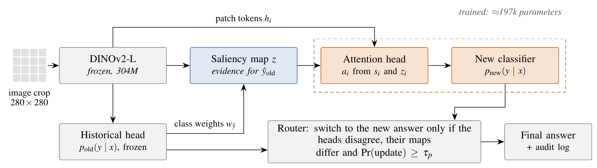
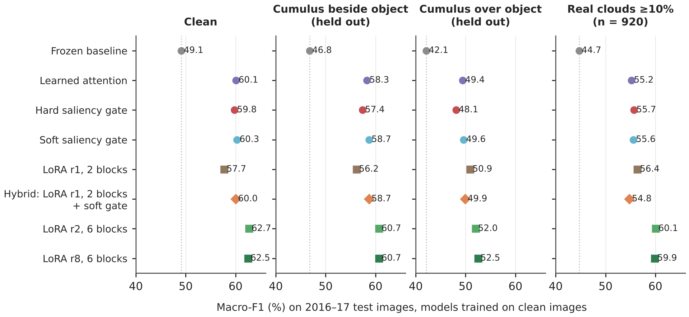
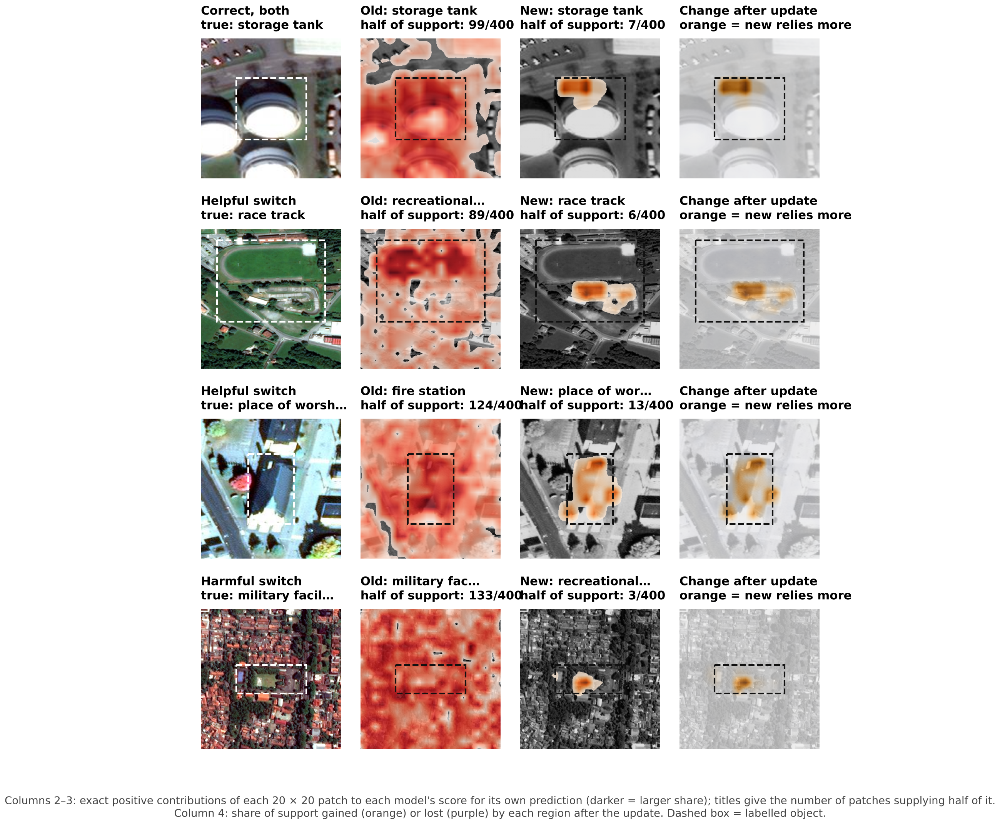

# Saliency-guided data drift mitigation on Vision Transformers

\# https://github.com/Rikhil-6/FYP

Final-year project. A frozen DINOv2-L/14 classifier is trained on 2010-13 satellite images (fMoW) and must be
updated for 2016-17 when its inputs drift (here: cloud cover that is absent before 2016 and present after).
The project asks whether the old model's own patch-level **saliency** makes that update more accurate, cheaper
or easier to audit than learned attention and LoRA. [docs/paper_guide.md](docs/paper_guide.md) maps every section of the accompanying paper to the code and outputs that
produce it.



## Headline results

Macro-F1 (%) on the 2016-17 test images, models trained on clean 2014-15 images, mean of three seeds
(42, 43, 44; the frozen baseline has one).

| Model | Trainable params | Backbone weights changed | Clean | Cloud beside | Cloud over | Real clouds |
|---|---|---|---|---|---|---|
| Frozen baseline | 0 | 0 | 49.1 | 46.8 | 42.1 | 44.7 |
| Learned attention | 197k | 0 | 60.1 | 58.3 | 49.4 | 55.2 |
| Hard saliency gate | 197k | 0 | 59.8 | 57.4 | 48.1 | 55.7 |
| Soft saliency gate | 197k | 0 | 60.3 | 58.7 | 49.6 | 55.6 |
| LoRA r1, last 2 blocks | 37k | 25 M | 58.1 | 56.8 | 50.6 | 55.2 |
| Hybrid: LoRA r1 + soft gate | 47k | 25 M | 59.8 | 58.2 | 49.8 | 54.9 |
| Hybrid: LoRA r2 + soft gate | 84k | 25 M | 60.7 | 59.4 | 50.8 | 58.0 |
| LoRA r2, 6 blocks | 221k | 75 M | **62.6** | **60.5** | **53.5** | **60.2** |
| LoRA r8, 6 blocks | 885k | 75 M | 62.5 | 60.8 | 53.0 | 60.3 |

- **Accuracy:** six-block LoRA is the most accurate update, and its lead over the heads grows as cloud exposure
  rises (3.5 points at 25% of test images, 5 points at 75%).
- **Saliency adds neither accuracy nor cloud robustness:** every saliency head is matched by a *shuffled twin*
  that receives the same saliency values in scrambled positions.
- **What the heads give:** training in about one minute on frozen features, no change to the backbone, and
  exact patch-by-patch explanations of the old and the updated decision. Saliency itself adds object-aligned
  weight (the hard gate puts 84% of its support on the labelled object, against 71% for learned attention) and
  more stable explanations across seeds.
- **Control:** about 7.5 of the 11-point lift from the heads comes from the head and about 3.5 from the recent images.




## Repository layout

| Path | Contents |
|---|---|
| `src/fyp_drift/` | Python package: data, models, training and all experiments (`evaluation/`, current work in `evaluation/fmow_v2/`) |
| `models/fmow_v2/` | Trained models (safetensors) with a one-line inference CLI |
| `results/fmow_v2/` | Saved per-seed outputs of every run with per-image predictions (`run_outputs/`), the generated `results_table.json` and `summary_tables.md`, the test labels and the site-overlap audit |
| `data_manifests/` | The exact list of 41,969 fMoW images used (and their acquisition metadata), so the subset can be downloaded from the public bucket |
| `figures/fmow_v2/` | Every figure, and the code and data that draw it |
| `scripts/` | Run scripts (`fmow_v2/`) and early pilots (`pilots/`) |
| `docs/` | Guides (below) and earlier protocol notes |
| `tests/` | Unit tests (`pytest`) |
| `deploy/` | Server setup and batch scripts |

The earlier CLEAR-100 version of the project (transparent router) is on the `initial` branch.

## Guides

| Guide | For |
|---|---|
| [Paper guide](docs/paper_guide.md) | What each paper section does, which code and outputs back it, how to rerun it |
| [Getting started](docs/getting_started.md) | Install, download the data, run, rebuild figures |
| [Data](docs/data.md) | fMoW source, subset, splits, preparation, clouds |
| [Code map](docs/code_map.md) | What each part of the code does, with an architecture diagram |
| [Experiment run order](docs/fmow_v2.md) | Every step, its command and output, protocol notes |
| [Trained models](docs/models.md) | Saved models, inference, re-exporting |

## Quick start

```bash
pip install -e . && pip install seaborn scipy safetensors
python -m fyp_drift.evaluation.fmow_v2.models predict models/fmow_v2/soft_gate my_site.jpg --map attention.png
```

Python 3.11. Training needs a GPU (a 16 GB T4 was used); inference with a saved model runs on CPU.


## Rebuilding the numbers and checking the repository

```bash
python -m fyp_drift.evaluation.fmow_v2.aggregate     # run_outputs/ + test_labels.npz -> results_table.json, summary_tables.md (CPU, seconds)
python -m fyp_drift.evaluation.fmow_v2.site_overlap  # cross-period site audit (needs the images' manifest)
PYTHONPATH=src pytest tests/test_fmow_v2_results.py  # aggregation, published tables, figure inputs, saved models; run by GitHub Actions
```

`summary_tables.md`, `results_table.json` and the result figures are generated from the raw runs and are not edited by hand.
Paths are set once in `scripts/fmow_v2/env.sh` (`FYP_ROOT` moves everything).
