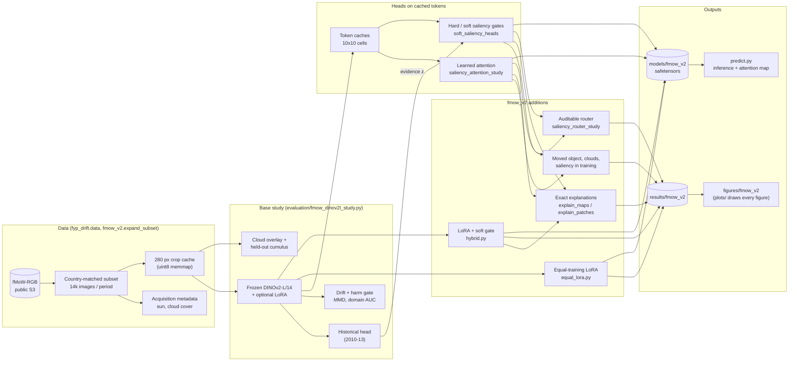

# Code map

`docs/code_digest.txt` is a full plain-text digest of the code (generated with
[gitingest](https://github.com/coderamp-labs/gitingest): `uvx gitingest . -o docs/code_digest.txt -e "results/*" -e "figures/*" -e "models/*"`),
handy for searching the code or giving it to an LLM. The diagram below is the architecture view in the style of
[GitDiagram](https://gitdiagram.com); GitHub renders it directly.

## Packages

| Path | What it does |
|---|---|
| `src/fyp_drift/data/` | Dataset loaders (CLEAR, corruptions, temporal sampling) and fMoW metadata download |
| `src/fyp_drift/models/` | ViT classifier, Siamese router and routing models from the earlier CLEAR-100 study |
| `src/fyp_drift/training/` | Training loops for the earlier study (classifier, fine-tuning, router, saliency pilots) |
| `src/fyp_drift/evaluation/` | Experiments. fMoW: `fmow_dinov2l_study.py` (data, backbone, clouds, LoRA, drift), `saliency_attention_study.py` and `soft_saliency_heads.py` (heads), `saliency_router_study.py` (router), `extra_metrics.py`, `fmow_token_dropping.py`, `strict_saliency_pooling.py` |
| `src/fyp_drift/evaluation/fmow_v2/` | v2 additions: equal-training LoRA, hybrid, held-out clouds, explanations, model export and inference |
| `src/fyp_drift/artifacts/`, `system/` | Run storage, reports, hardware checks |
| `scripts/fmow_v2/` | Environment file and the equal-training runner |
| `scripts/pilots/` | One-off pilot scripts from 3 Nov, kept for the record (superseded by `evaluation/`) |
| `deploy/` | Server setup and batch scripts for the earlier study |
| `tests/` | Unit tests (`pytest`) |
| `results/fmow_v2/` | Saved output of every v2 run, with per-image predictions |
| `figures/fmow_v2/` | Every figure plus the code and data that draw it |
| `models/fmow_v2/` | Trained models (safetensors) for inference |

## v2 modules (`src/fyp_drift/evaluation/fmow_v2/`)

| Module | Role |
|---|---|
| `expand_subset.py` | Download the 14k-per-period country-matched subset |
| `cloud_tokens.py`, `pool_tokens.py`, `heldout_tokens.py` | Build the frozen-token caches (overlay, 2x2 pooling, held-out cumulus) |
| `context.py` | Shared splits, image cache, cloud settings and frozen head |
| `equal_lora.py` | LoRA with the heads' selection protocol (`--rank --blocks --condition --seed`) |
| `hybrid.py` | LoRA + soft saliency gate trained end to end |
| `shift_test.py` | Moved-object grounding test |
| `cloud_pooling.py` | Cloud-aware pooling and the head-width sweep |
| `saliency_learning.py` | Saliency in the training signal only |
| `analysis.py` | Map stability, real-cloud scores, example maps |
| `explain_maps.py`, `explain_patches.py` | Exact per-cell / per-patch explanations |
| `models.py`, `export_heads.py`, `predict.py` | Save, load and run trained models |
