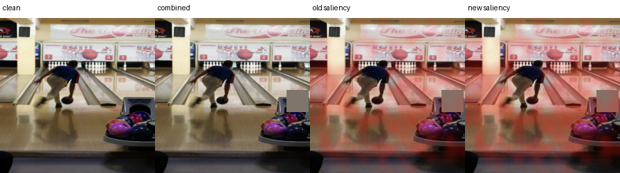
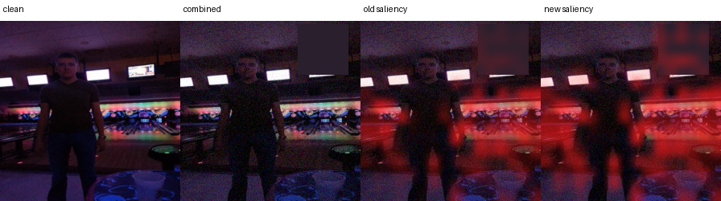

# Transparent Saliency Routing for Temporal Image Drift

*An explainable ViT-only prototype for temporally ordered image classification*

## Abstract

This study tests a transparent update mechanism for image classifiers exposed to temporal drift. A historical Vision Transformer is compared with a newer saliency-guided ViT adapted on later data. A small, explicit router chooses between their predictions using observable changes in confidence, entropy, class evidence, and patch saliency. Evaluation follows a fixed chronology from historical training through a frozen 2012–2014 horizon. The strongest updated model improves 2014 combined-drift macro F1 by 1.65 percentage points over historical XAI; routing retains 91.5% of that gain. The predeclared three-point target is not reached. The result supports inspectable drift correction while showing that the incremental benefit of explicit saliency supervision is modest.

[PAGEBREAK]

## 1. Research question

Can a transparent, saliency-aware routing rule decide when a drift-adapted ViT should replace a historical ViT prediction, while preserving accuracy on clean data and improving performance as temporal drift accumulates?

Image classifiers are often evaluated as if their deployment distribution were fixed. Real systems rarely remain static. Camera hardware changes, image compression is revised, illumination follows seasonal patterns, backgrounds evolve, and the frequency of classes shifts. A model can therefore remain available while its error profile gradually changes. Temporal drift is difficult precisely because it is incremental: there may be no single moment at which the old model obviously fails.

This project separates three decisions that are frequently mixed together. Historical training determines the original model. Temporal adaptation determines how a candidate model learns from a newer window. Routing determines whether the candidate should answer a particular sample. Separating these decisions makes the source of a gain easier to identify and allows the historical model to remain an auditable fallback.

The study deliberately uses a fixed chronology instead of randomly mixing years. Earlier images train and select the historical system. A later period supports adaptation, the following period calibrates the route policy, and the final years remain untouched until evaluation. This arrangement resembles a deployment cycle and prevents later labels from silently shaping an earlier decision.

The intended contribution is methodological. The project does not claim a new state-of-the-art classifier. It tests whether update decisions can be made visible through saved saliency maps, confidence changes, entropy changes, class evidence, explicit coefficients, and outcome counts. The failure to reach the strongest target is retained as part of the evidence.

[PAGEBREAK]

## 2. System design

The prototype contains three ViT-only variants:

1. **Baseline ViT:** a frozen historical classifier.
2. **XAI ViT:** the same class of model with attention-derived saliency used during learning and evaluation.
3. **Transparent update router:** a historical XAI ViT and a drift-adapted XAI ViT evaluated as a pair. A calibrated logistic rule selects the newer prediction only when its visible evidence passes the learned threshold and a minimum saliency-change floor.

The router inputs are **saliency Jensen–Shannon divergence**, **confidence gain**, **entropy reduction**, and **class-evidence gain**. Every routed sample is logged with the feature values, route probability, selected model, correctness, and saliency images.

The baseline and historical XAI models are trained once on the historical period and then frozen. They are not retrained separately for every evaluation year. This ensures that the 2012, 2013, and 2014 scores measure increasing distance from the same deployed reference. The newer branch is also fixed after 2011 calibration, so the final horizon does not become another optimization loop.

The three classifier views serve different analytical roles. Baseline ViT measures a conventional transformer pipeline without the saliency-gated head. Historical XAI controls for the embedded explanation architecture. Updated XAI measures the maximum benefit available from adaptation when it is always selected. Routed XAI then measures how much of that benefit survives a conditional, inspectable decision policy.

[PAGEBREAK]

### 2.1 ViT classifier and embedded explanation

DINOv2-small produces one class token and a grid of patch tokens. The baseline averages patch evidence uniformly. The XAI model learns a scalar gate for every patch, normalises those gates into a saliency distribution, and uses the saliency-weighted patch sum together with the class token for classification. The same weights therefore affect the logits directly: the map is part of the forward computation rather than a detached visualisation.

For faithfulness training, the model also classifies the complementary low-saliency patches. The loss rewards greater evidence for the true class in selected patches than in their complement. During update training, a pairwise term keeps the new and historical maps close when the historical prediction is correct and requires a minimum divergence when it is wrong.

The learned map answers a limited but concrete question: which ViT patch tokens received weight in the representation used for classification? It is not treated as a segmentation mask. A concentrated map can still be wrong, and a diffuse map can still support a correct prediction. The report therefore avoids interpreting visual neatness as proof of faithfulness.

The complementary path adds a falsifiable expectation. If the selected patches truly carry class-specific evidence, the remaining low-saliency patches should provide weaker evidence for the correct class. This relationship is optimized softly alongside classification rather than imposed as a hard rule that could suppress useful context.

During paired adaptation, the frozen branch supplies a stable point of comparison. When the historical prediction is correct, unnecessary explanation movement is discouraged. When it is wrong, the newer branch is permitted and encouraged to move its spatial evidence. Correctness still comes from the class label; saliency divergence alone never counts as a successful update.

[PAGEBREAK]

### 2.2 Explicit routing rule

For a sample `x`, the old and new ViTs produce predictions and saliency distributions. The policy standardises four observable differences and applies a saved logistic equation. The newer prediction is eligible only when the models disagree, saliency divergence exceeds a calibrated floor, and the logistic probability exceeds its calibrated threshold. All coefficients, means, scales, and thresholds are stored in `router_policy.json`.

The policy can be written as `p(update | x) = sigmoid(b + w^T z)`, where `z` contains the four standardized features. The intercept, coefficients, feature means, and feature scales are stored with the thresholds. Given the two model outputs and the policy file, a route can therefore be reproduced without access to a hidden routing network.

Saliency divergence measures how much the spatial evidence distribution changed. Confidence gain measures whether the newer branch is more certain in its selected class. Entropy reduction measures whether its full predictive distribution became more concentrated. Class-evidence gain measures whether the newer representation provides stronger support for the candidate class. No feature is assumed to be sufficient in isolation.

Coefficient signs describe associations in the 2011 calibration sample. A positive confidence coefficient means that confidence gain was associated with useful updates after the other features were considered. It does not prove that increasing confidence would cause correctness. The router is transparent as a policy, while its statistical relationships remain empirical.

### 2.3 Related work and design rationale

The supplied literature supports using explanations as trainable evidence rather than detached illustrations. Yao and Gong constrain self-attention with saliency priors to limit attention spreading into irrelevant regions [6]. XGD combines prediction alignment with saliency-based feature refinement and tests the contribution through ablation [7]. Ismail et al. perturb low-saliency features while preserving predictive consistency, directly connecting saliency to model behaviour [11]. These findings motivate the learned patch gate, complementary low-saliency path, and explicit saliency losses used here.

The paired-model design follows Siamese comparison while preserving temporal asymmetry. Siamese-ViT shows that weight-sharing ViT branches support comparison across changed views [8], while Asymmetric Siamese Networks show that temporal observations from different distributions may need deliberately different roles [12]. This project therefore freezes the historical branch as an auditable reference and adapts only the newer branch.

Saliency Guided Image Warping argues that changing backgrounds can dominate domain adaptation while smaller foreground regions remain underrepresented [10]. DiXtill similarly transfers explanation agreement alongside predictive behaviour [9]. The resulting hypothesis is narrow: saliency guidance should help most when class semantics remain stable but nuisance appearance or contextual shortcuts change. It is less suitable for new classes, label-definition drift, complete object loss, or cases where the relevant visual evidence itself disappears.

| Literature-supported idea | Project implementation | Testable implication |
|---|---|---|
| Saliency constrains diffuse attention [6] | Patch weights directly determine the ViT feature sum | Removing highly weighted patches should change class evidence more than removing low-weight patches |
| Saliency objectives can be isolated by ablation [7, 11] | Matched control removes only the auxiliary saliency losses | Any difference can be attributed to those losses within the fixed run, subject to sampling limits |
| Paired views support comparison [8, 12] | Frozen historical ViT and adapted newer ViT | Old/new disagreements can be audited sample by sample |
| Background shift can dominate adaptation [10] | Saturation, noise, occlusion, and temporal context are evaluated separately | Benefits should concentrate where stable class evidence survives the nuisance shift |
| Explanations can guide transfer [9] | Saliency divergence and complementary evidence enter learning and routing | Route decisions remain numerically traceable |

[PAGEBREAK]

## 3. Temporal protocol

| Stage | Years | Role |
|---|---:|---|
| Historical training | 2004–2008 | Fit the original ViT models |
| Model selection | 2009 | Choose checkpoints without touching future years |
| Drift adaptation | 2010 | Update the newer XAI ViT with a balanced clean/corrupted stream |
| Router calibration | 2011 | Fit the explicit routing rule and threshold |
| Frozen evaluation | 2012–2014 | Test clean and drifted data once across a future horizon |

The optional drift generator applies modest saturation shifts, Gaussian sensor noise, and partial occlusion. Individual corruptions appear during adaptation and calibration; their combined composition is withheld until final testing. This follows the corruption-testing motivation of ImageNet-C and AugMix while preserving chronological separation.

The clean stream and the corrupted stream answer different questions. Clean year-by-year evaluation measures performance on the naturally ordered dataset. Corruption tests measure sensitivity when plausible visual degradation is added to that chronology. Synthetic corruption is therefore not presented as the source of the underlying temporal drift.

Saturation represents changes in illumination or camera colour processing. Gaussian noise approximates sensor and transmission degradation. Partial occlusion represents obstruction, cropping, dirt, or an intervening object. Severity is bounded and logged so that the stress test remains interpretable rather than making the original image unrecognizable.

The combined condition is reserved for final evaluation. Adaptation and calibration use individual corruption families, so success on the composition measures limited generalization beyond the exact perturbation pattern seen during updating.

[PAGEBREAK]

### 3.1 Enhanced correction experiment

The newly added `--adaptation-profile enhanced` mode is a predeclared attempt to increase the separation between the historical ViT and the saliency-responsive correction model without changing the test set. It changes only the 2010 adaptation procedure:

- 25% clean and 75% individually corrupted samples, spanning severities 1–3;
- the final three transformer blocks are trainable instead of only the final block;
- backbone learning rate remains `1e-5`, while classifier and saliency heads use `5e-5`;
- label smoothing is `0.05` and the saliency terms receive weight `0.25`;
- the saliency divergence margin increases from `0.05` to `0.08`;
- router calibration jointly selects a saliency-floor quantile and probability threshold on 2011 only.

The completed enhanced run reused the same historical checkpoint, seed 42, 2011 calibration set, and frozen 2012–2014 evaluation streams. Combined corruption remained unavailable during adaptation and calibration. Epoch 4 was selected by 2011 macro F1 (**94.39%**); epoch 5 declined to **93.00%**, indicating overfitting after the selected checkpoint. Training took approximately **138 seconds per epoch** after warm-up.

[PAGEBREAK]

### 3.2 Hypotheses and success criteria

- **H1:** enhanced saliency adaptation improves 2014 combined-drift macro F1 by at least **3.00 percentage points** over the original baseline ViT.
- **H2:** transparent routing retains at least 75% of the gain achieved by always using the updated model.
- **H3:** clean 2014 macro F1 does not fall by more than 0.50 points relative to the historical XAI model.

The 3-point value is a target fixed before viewing the enhanced results. Failure to reach it must be reported as a negative result rather than addressed by tuning on 2012–2014 labels.

[PAGEBREAK]

### 3.3 Enhanced result against the hypotheses

- **H1 not met:** the updated model improved by **1.40 points** over baseline ViT, below the 3.00-point target.
- **H2 met:** routing retained `(91.85−90.34)/(91.99−90.34) = 91.5%` of the newer model's gain over historical XAI.
- **H3 met:** routed clean 2014 macro F1 was **95.30%**, 0.06 points above historical XAI.

[PAGEBREAK]

### 3.4 Checkpoint and interruption recovery

Every evaluated epoch atomically replaces `models/resume.pt` and writes a small `resume.json`. The binary checkpoint contains the newer ViT parameters, optimizer state, completed epoch, and best validation score; the separate best-model file remains the checkpoint used for final evaluation. The matched standard run was deliberately stopped after epoch 2 and resumed at epoch 3. It retained the epoch-2 optimizer and best score, later selected epoch 4, and completed the frozen horizon normally. A local round-trip regression test independently reloads and compares weights, optimizer state, epoch, score, and metadata.

[PAGEBREAK]

## 4. Main results

Macro F1 is shown as a percentage. Helpful and harmful routes count cases where choosing the newer model corrected or introduced an error, respectively.

| Scenario | Year | Baseline | Historical XAI | Updated XAI | Routed | Helpful | Harmful |
|---|---:|---:|---:|---:|---:|---:|---:|
| Clean | 2012 | 95.86 | 95.96 | 96.56 | 96.40 | 30 | 8 |
| Clean | 2013 | 95.27 | 95.23 | 96.13 | 95.79 | 40 | 12 |
| Clean | 2014 | 95.13 | 95.24 | 95.85 | 95.46 | 30 | 18 |
| Combined | 2012 | 95.47 | 95.47 | 96.17 | 96.08 | 45 | 14 |
| Combined | 2013 | 93.75 | 93.81 | 94.71 | 94.55 | 72 | 32 |
| Combined | 2014 | 90.59 | 90.34 | 91.75 | 91.50 | 120 | 48 |

On 2014 combined drift, the baseline reaches **90.59%**, the historical XAI model **90.34%**, the updated XAI model **91.75%**, and the transparent router **91.50%** macro F1. The router captures `(91.50−90.34)/(91.75−90.34) = 82.3%` of the available update gain. The updated model also remains stronger on clean images, although the router becomes more conservative and records 18 harmful routes against 30 helpful routes in 2014.

[PAGEBREAK]

### 4.1 Enhanced profile results

| Scenario | Year | Historical XAI | Enhanced XAI | Enhanced routed | Helpful | Harmful |
|---|---:|---:|---:|---:|---:|---:|
| Clean | 2012 | 95.96 | 95.89 | 96.03 | 65 | 62 |
| Clean | 2013 | 95.23 | 95.49 | 95.55 | 60 | 44 |
| Clean | 2014 | 95.24 | 95.47 | 95.30 | 69 | 64 |
| Combined | 2012 | 95.47 | 95.71 | 95.81 | 76 | 58 |
| Combined | 2013 | 93.81 | 94.43 | 94.44 | 101 | 66 |
| Combined | 2014 | 90.34 | 91.99 | 91.85 | 188 | 90 |

The enhanced curriculum improved the always-new 2014 combined score from **91.75% to 91.99%**, a further **0.24 points**. The routed score increased from **91.50% to 91.85%**, a further **0.35 points**. The modest change indicates that simply increasing adaptation capacity is insufficient to create a 3-point separation.

[PAGEBREAK]

### 4.2 Controlled five-epoch ablation

The matched run removes the earlier three-versus-five-epoch imbalance. The auxiliary-loss control keeps the enhanced curriculum, trainable blocks, learning rates, and saliency-gated classifier fixed, but sets the pairwise saliency-divergence and complementary-evidence loss weights to zero. It therefore isolates the explicit saliency supervision while retaining saliency inside the forward pass.

| Configuration | 2014 clean routed | Combined old | Combined new | Combined routed | Helpful | Harmful |
|---|---:|---:|---:|---:|---:|---:|
| Matched standard (5 epochs) | 95.78 | 90.34 | 91.68 | 91.72 | 144 | 57 |
| Enhanced with auxiliary saliency losses | 95.30 | 90.34 | 91.99 | 91.85 | 188 | 90 |
| Enhanced without auxiliary saliency losses | 95.45 | 90.34 | 91.86 | 91.62 | 125 | 43 |

Against the matched enhanced control, the explicit auxiliary saliency objectives changed 2014 combined macro F1 by **+0.13 points** for always-new inference and **+0.23 points** after routing. These are single-run paired differences, not confidence-bounded causal estimates.

[PAGEBREAK]

## 5. What the saliency panels show

Each panel places the input beside the historical and updated attention maps, then prints the router features and decision. This makes a route auditable: a reviewer can compare *where* each ViT looked with the numerical evidence used by the logistic rule.

[PAGEBREAK]

### 5.1 Quantitative saliency outcome analysis

For the 2014 combined-drift auxiliary-loss control, helpful routes had mean saliency Jensen-Shannon divergence **0.0607**, compared with **0.0512** for harmful routes and **0.0473** when the historical prediction was retained. Mean route probability was **0.821** for helpful routes, **0.767** for harmful routes, and **0.310** for retained historical predictions. There were **125 helpful versus 43 harmful routes** (ratio 2.91). The matched standard run showed the same within-run ordering for helpful versus harmful divergence (0.00759 versus 0.00651), although raw divergence magnitudes should not be compared across differently adapted models.

The distributions overlap substantially. Saliency change clearly separates routed from retained examples, because it is an explicit eligibility condition, while it only modestly separates helpful from harmful routes. In the inspected panels, maps often emphasize contextual regions such as a bowling lane, cloud structure, or framed display area. They are evidence gates rather than object masks, so their spatial overlap must not be presented as segmentation IoU.

### 5.2 Counterexample and faithfulness audit

The full 2014 combined-drift stream contains **4,999** images. The enhanced router makes **188 helpful switches** where the historical model is wrong and the newer model is correct, **90 harmful switches** in the opposite direction, and misses **17** available corrections. It therefore produces **98 net corrected predictions**. These counts explain why the overall score changes modestly even though some individual decisions change substantially.

For every one of the 304 samples where one model is correct and the other is wrong, the audit deletes the top 20% and bottom 20% of patches under each model's own saliency map. The faithfulness margin is the drop in true-class probability after high-saliency deletion minus the drop after low-saliency deletion. For helpful routed cases, the newer model has a mean margin of **0.175**, compared with **0.010** on harmful routed cases; **72.3%** of helpful routes have a positive new-model margin, compared with **57.8%** of harmful routes. Conversely, the historical model's mean margin is **0.048** on helpful routes and **0.182** on harmful routes. This reversal is consistent with the intuitive routing goal: the model that is correct tends to have the more behaviourally consequential map.

The helpful example raises true-class probability from **0.060** in the historical model to **0.403** in the updated model; deleting the newer model's most salient patches causes a **0.372** larger confidence drop than deleting its least salient patches. The harmful example shows why saliency change alone is insufficient: the historical model was already correct and its map had the stronger deletion response. These perturbation results remain observational. Patch deletion introduces an artificial input and does not prove that the highlighted pixels caused adaptation.

### 5.3 Where saliency-guided drift correction is credible

The most credible deployment setting is class-conditional covariate drift: labels and object identity remain stable while acquisition or context changes. Examples include camera replacement, compression and sensor noise, shifts in white balance or saturation, changing illumination and season, partial occlusion, and background or viewpoint changes that break a historical shortcut. Saliency guidance is useful when the stable evidence is still visible and the newer model can reweight it. The present combined condition approximates several such changes simultaneously while the CLEAR chronology supplies real temporal variation.

The method should not be expected to solve concept drift where the label meaning changes, new-class emergence, extreme occlusion, or systematic dataset errors. In those cases the saliency map may faithfully explain a wrong premise. A stronger next experiment should therefore add a matched random-mask control and an external temporal dataset, then compare confidence-only, saliency-only, and deletion-aware routers without tuning on the final horizon.

[PAGEBREAK]

## 6. Interpretation and limits

The longer test horizon exposes a clearer decline under compound drift and a larger benefit from drift-aware updating. The rule remains explainable because its four standardized inputs, coefficients, threshold, and saliency floor are saved in `router_policy.json`. Coefficient signs are empirical correlations from 2011 calibration, not causal explanations.

The evidence is limited to one seed, one temporal dataset stream, synthetic corruptions, and one fitted threshold. Checkpoint selection and router calibration both reuse 2011 examples. No confidence intervals or multi-seed hypothesis tests are reported. The enhanced configuration produced a valid negative result for H1: the gain remained below 3 points. The auxiliary saliency-loss contribution is positive but small, and the overlapping outcome distributions do not support a strong causal explanation claim.

The next defensible step is repeated temporal backtesting with bootstrap confidence intervals and an untouched external dataset. The router should also be compared with always-old, always-new, confidence-only, and saliency-only ablations. Report macro F1 and macro IoU by year and drift type, helpful and harmful routes, update-trigger precision/recall, throughput, and training time per epoch.

[PAGEBREAK]

## 7. Reproducibility artifacts

- `long_horizon_summary.json`: compact protocol, scores, and router policy.
- `router_policy.json`: learned standardized logistic coefficients and thresholds.
- `20260928T161159Z-horizon-router/`: 45 saved saliency panels plus sample metadata.
- Enhanced server run: `runs/siamese/20260929-enhanced-3pp/`.
- Controlled server runs: `runs/siamese/20261005-standard-5ep/` and `runs/siamese/20261005-enhanced-nosaliency/`.
- `20261005-ablation/comparison.json`: matched-control check, epoch traces, policies, and compact scores.
- `20261005-ablation/enhanced-full-panels/` and `enhanced-nosaliency-panels/`: 90 bounded saliency panels with sample-level metadata.
- `20261005-ablation/*/saliency_route_*`: outcome-stratified CSV, JSON, headline JSON, and figure.
- `20261005-counterexamples/`: all 4,999 decisions, a 304-case deletion audit, 24 bounded counterexample panels, and a compact JSON summary.
- Source checkpoints remain server-side because each model file is about 85 MB.

## References

1. Dosovitskiy et al. (2020), *An Image is Worth 16×16 Words: Transformers for Image Recognition at Scale*. https://arxiv.org/abs/2010.11929
2. Oquab et al. (2023), *DINOv2: Learning Robust Visual Features without Supervision*. https://arxiv.org/abs/2304.07193
3. Hendrycks and Dietterich (2019), *Benchmarking Neural Network Robustness to Common Corruptions and Perturbations*. https://arxiv.org/abs/1903.12261
4. Hendrycks et al. (2019), *AugMix: A Simple Data Processing Method to Improve Robustness and Uncertainty*. https://arxiv.org/abs/1912.02781
5. Lin et al. (2021), *CLEAR: A Benchmark for Continual Learning on Real-World Imagery*. https://clear-benchmark.github.io/
6. Yao and Gong (2020), *Saliency Guided Self-attention Network for Weakly and Semi-supervised Semantic Segmentation*. arXiv:1910.05475.
7. Nguyen et al. (2025), *XGD: Explainable AI-Guided Knowledge Distillation with Feature Refinement for Semantic Segmentation*. 38th Canadian Conference on Artificial Intelligence.
8. Cheng et al. (2026), *Siamese-ViT: A Local–Global Feature Fusion Method for Real-Time Visual Navigation of UAVs in Real-World Environments*. Remote Sensing, 18, 1556. https://doi.org/10.3390/rs18101556
9. Cantini, Orsino, and Talia (2024), *XAI-driven knowledge distillation of large language models for efficient deployment on low-resource devices*. Journal of Big Data, 11, 63. https://doi.org/10.1186/s40537-024-00928-3
10. Zheng, Ghosh, and Narasimhan (2024), *Saliency Guided Image Warping for Unsupervised Domain Adaptation*. arXiv:2403.12712.
11. Ismail, Feizi, and Corrada Bravo (2021), *Improving Deep Learning Interpretability by Saliency Guided Training*. Advances in Neural Information Processing Systems.
12. Yang et al. (2021), *Semantic Change Detection with Asymmetric Siamese Networks*. arXiv:2010.05687.
