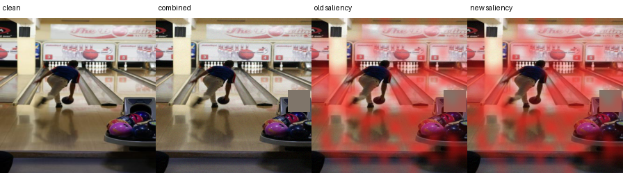
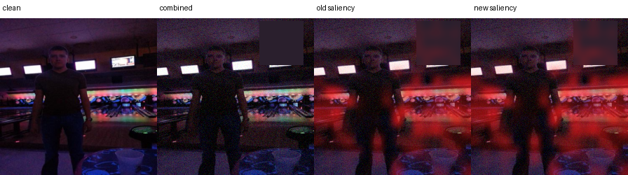

# Transparent Saliency Routing for Temporal Image Drift

*A compact mock research paper based on the fixed-horizon prototype run*

## Abstract

This prototype tests whether a fully vision-transformer pipeline can respond to temporal image drift while keeping its update decision inspectable. A historical ViT is trained on 2004–2008 images and selected on 2009. A newer XAI-regularised ViT is adapted on 2010 images with realistic mild corruptions. An explicit router is calibrated on 2011 and evaluated once on the untouched 2012–2014 horizon. The router uses visible changes in saliency and prediction evidence rather than an opaque routing embedding. Under the strongest combined drift in 2014, the updated model improves macro F1 by **1.41 percentage points** over the historical XAI model; the router retains **1.16 points**, or **82.3%** of the available update gain. These are exploratory single-run results rather than a final statistical claim.

## 1. Research question

Can a transparent, saliency-aware routing rule decide when a drift-adapted ViT should replace a historical ViT prediction, while preserving accuracy on clean data and improving performance as temporal drift accumulates?

## 2. System design

The prototype contains three ViT-only variants:

1. **Baseline ViT:** a frozen historical classifier.
2. **XAI ViT:** the same class of model with attention-derived saliency used during learning and evaluation.
3. **Transparent update router:** a historical XAI ViT and a drift-adapted XAI ViT evaluated as a pair. A calibrated logistic rule selects the newer prediction only when its visible evidence passes the learned threshold and a minimum saliency-change floor.

The router inputs are **saliency Jensen–Shannon divergence**, **confidence gain**, **entropy reduction**, and **class-evidence gain**. Every routed sample is logged with the feature values, route probability, selected model, correctness, and saliency images.

## 3. Temporal protocol

| Stage | Years | Role |
|---|---:|---|
| Historical training | 2004–2008 | Fit the original ViT models |
| Model selection | 2009 | Choose checkpoints without touching future years |
| Drift adaptation | 2010 | Update the newer XAI ViT with a balanced clean/corrupted stream |
| Router calibration | 2011 | Fit the explicit routing rule and threshold |
| Frozen evaluation | 2012–2014 | Test clean and drifted data once across a future horizon |

The optional drift generator applies modest saturation shifts, Gaussian sensor noise, and partial occlusion. Individual corruptions appear during adaptation and calibration; their combined composition is withheld until final testing. This follows the corruption-testing motivation of ImageNet-C and AugMix while preserving chronological separation.

## 4. Main results

Macro F1 is shown as a percentage. Helpful and harmful routes count cases where choosing the newer model corrected or introduced an error, respectively.

| Scenario | Year | Baseline | Historical XAI | Updated XAI | Routed | Helpful | Harmful |
|---|---:|---:|---:|---:|---:|---:|---:|
| Clean | 2012 | 95.86 | 95.96 | 96.56 | 96.40 | 30 | 8 |
| Clean | 2013 | 95.27 | 95.23 | 96.13 | 95.79 | 40 | 12 |
| Clean | 2014 | 95.13 | 95.24 | 95.85 | 95.46 | 30 | 18 |
| Combined | 2012 | 95.47 | 95.47 | 96.17 | 96.08 | 45 | 14 |
| Combined | 2013 | 93.75 | 93.81 | 94.71 | 94.55 | 72 | 32 |
| Combined | 2014 | 90.59 | 90.34 | 91.75 | 91.50 | 120 | 48 |

On 2014 combined drift, the baseline reaches **90.59%**, the historical XAI model **90.34%**, the updated XAI model **91.75%**, and the transparent router **91.50%** macro F1. The router captures `(91.50−90.34)/(91.75−90.34) = 82.3%` of the available update gain. The updated model also remains stronger on clean images, although the router becomes more conservative and records 18 harmful routes against 30 helpful routes in 2014.

## 5. What the saliency panels show

Each panel places the input beside the historical and updated attention maps, then prints the router features and decision. This makes a route auditable: a reviewer can compare *where* each ViT looked with the numerical evidence used by the logistic rule.

## 6. Interpretation and limits

The longer test horizon exposes a clearer decline under compound drift and a larger benefit from drift-aware updating. The rule remains explainable because its four standardized inputs, coefficients, threshold, and saliency floor are saved in `router_policy.json`. Coefficient signs are empirical correlations from 2011 calibration, not causal explanations.

The evidence is limited to one seed, one temporal dataset stream, synthetic corruptions, and one fitted threshold. No confidence intervals or multi-seed hypothesis tests are reported. The next defensible step is repeated temporal backtesting with bootstrap confidence intervals and an untouched external dataset. The router should also be compared with always-old, always-new, confidence-only, and saliency-only ablations.

## 7. Reproducibility artifacts

- `long_horizon_summary.json`: compact protocol, scores, and router policy.
- `router_policy.json`: learned standardized logistic coefficients and thresholds.
- `20260928T161159Z-horizon-router/`: 45 saved saliency panels plus sample metadata.
- Source checkpoints remain server-side because each model file is about 85 MB.

## References

1. Dosovitskiy et al. (2020), *An Image is Worth 16×16 Words: Transformers for Image Recognition at Scale*. https://arxiv.org/abs/2010.11929
2. Oquab et al. (2023), *DINOv2: Learning Robust Visual Features without Supervision*. https://arxiv.org/abs/2304.07193
3. Hendrycks and Dietterich (2019), *Benchmarking Neural Network Robustness to Common Corruptions and Perturbations*. https://arxiv.org/abs/1903.12261
4. Hendrycks et al. (2019), *AugMix: A Simple Data Processing Method to Improve Robustness and Uncertainty*. https://arxiv.org/abs/1912.02781
5. Lin et al. (2021), *CLEAR: A Benchmark for Continual Learning on Real-World Imagery*. https://clear-benchmark.github.io/
