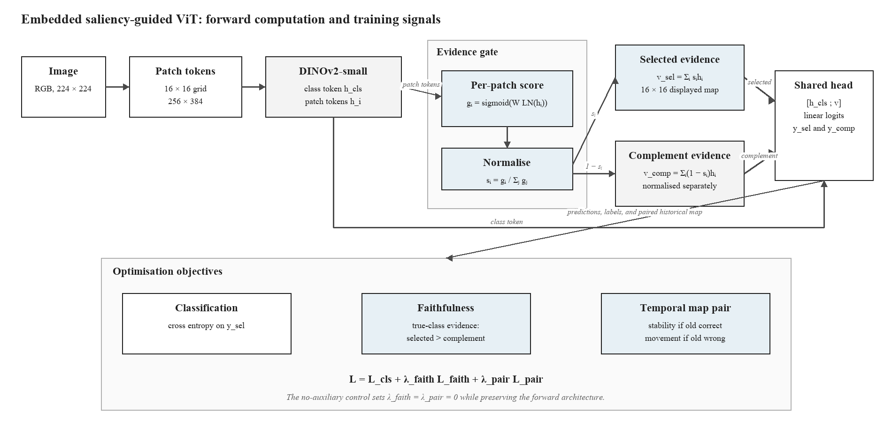
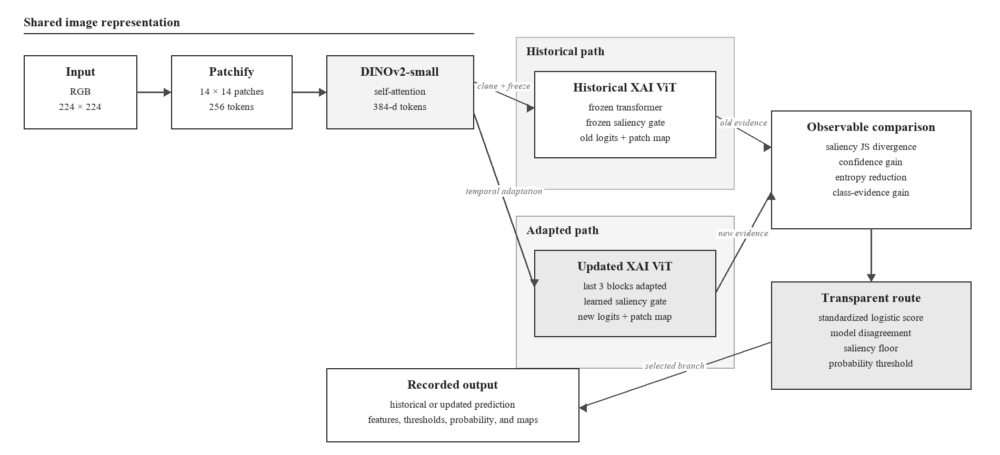
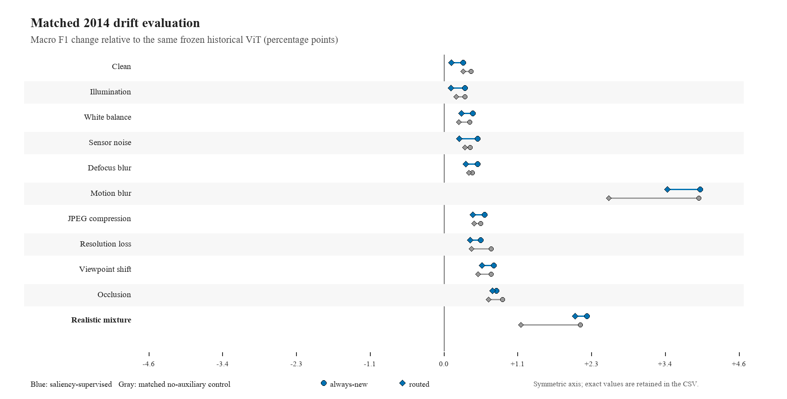
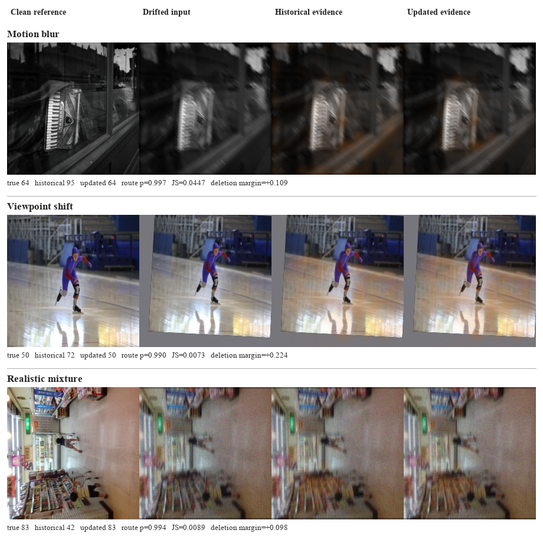
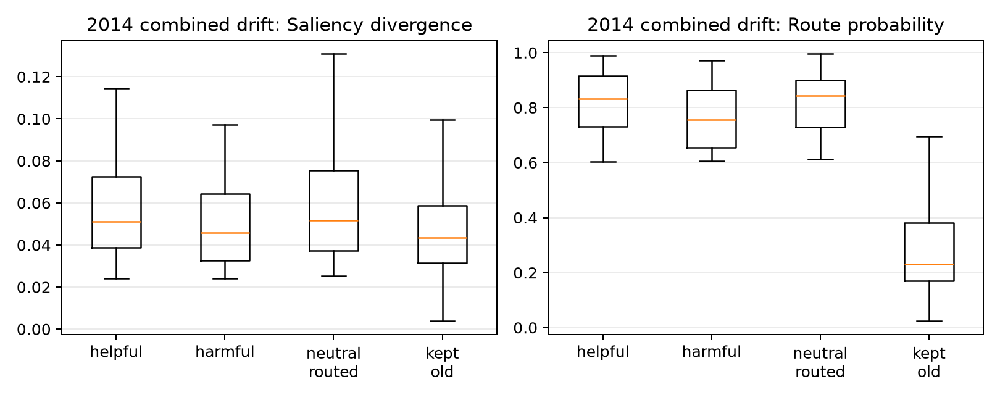
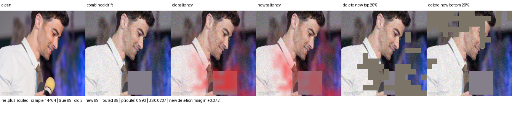
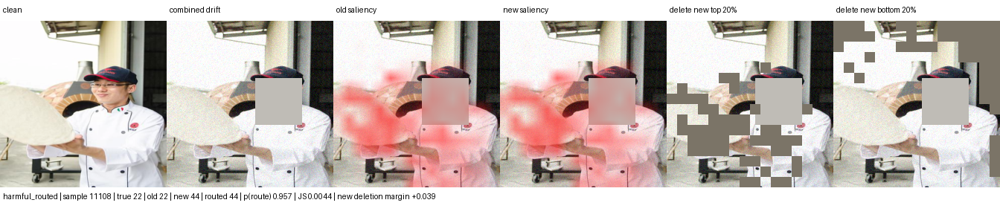

# Transparent Saliency Routing for Temporal Image Drift

*An explainable ViT-only prototype for temporally ordered image classification*

## Abstract

This study tests a transparent update mechanism for image classifiers exposed to temporal drift. A historical Vision Transformer is compared with a newer saliency-guided ViT adapted on later data. A small, explicit router chooses between their predictions using observable changes in confidence, entropy, class evidence, and patch saliency. Evaluation follows a fixed chronology from historical training through a frozen 2012–2014 horizon. In the expanded, source-separated 2014 evaluation, routing improves macro F1 over the same frozen historical ViT by 3.45 percentage points under motion blur and 2.03 points under a realistic mixture of acquisition changes, while changing clean performance by only 0.12 points. Against a matched control that removes the auxiliary saliency losses but preserves the architecture and training budget, those routing gains are 0.90 and 0.84 points larger, respectively. The original predeclared three-point target remains unmet on the earlier combined condition, so the stronger motion-blur result is reported as a source-specific finding rather than a replacement primary endpoint. The evidence supports inspectable drift correction while showing that explicit saliency supervision helps selectively rather than uniformly.

## 1. Introduction and thesis

Image classification systems are commonly developed under an implicit stationarity assumption: training, validation, and deployment images are expected to represent the same underlying distribution. That assumption is fragile in operational settings. Camera hardware and image-processing pipelines are replaced, illumination and weather vary, compression settings change, viewpoints and backgrounds evolve, and the prevalence of individual classes can shift. ImageNet-C demonstrates that ordinary noise, blur, weather, and digital degradation can substantially reduce classification accuracy [1], while CLEAR shows that visual concepts also evolve naturally across a decade even without an artificial corruption boundary [2]. WILDS extends this concern to changes across camera locations, geography, institutions, and time [3]. A deployed classifier may therefore continue to operate normally while becoming progressively less reliable on particular classes or acquisition conditions.

Continual adaptation offers one response, but automatically replacing a historical model creates a second problem: an updated model can correct some failures while introducing new ones. A deployment decision consequently requires more than evidence that the aggregate score improved. It should expose which model changed, why a particular sample was routed to it, and how many switches helped or harmed. This project separates historical model fitting, temporal adaptation, and sample-level routing so each stage can be evaluated independently. The historical classifier remains frozen as a reference; a newer classifier adapts on a bounded later window; and an explicit policy decides which prediction to use after comparing the two models.

The explanation mechanism is motivated by work that treats saliency as a training signal rather than a decorative post-hoc picture. Yao and Gong use saliency priors to constrain self-attention that would otherwise spread into irrelevant regions [4]. XGD combines predictive alignment with saliency-based feature refinement and evaluates the contribution of its explanation objectives through ablation [5]. Related XAI-driven knowledge distillation work applies the broader principle that explanation information can influence model transfer, although its language-model setting is not used as architectural evidence here [6]. Ismail et al. perturb low-saliency features while enforcing predictive consistency, connecting the explanation map to observable model behaviour [7]. Saliency Guided Image Warping further argues that domain adaptation can become dominated by changing backgrounds while smaller foreground regions remain underrepresented [8]. Together, these studies motivate a classifier whose patch weights participate directly in prediction and whose explanations can be tested through masking rather than judged only by appearance.

The temporal comparison also draws on Siamese reasoning. Siamese-ViT shows that paired transformer branches can support comparison across changed views [9], while asymmetric Siamese networks show that observations from different temporal distributions can require different roles [10]. The present architecture therefore uses the same ViT family on both sides but freezes the historical branch and adapts only the newer branch. Their relationship is intentionally asymmetric: one represents established behaviour and the other represents a candidate update. Both branches are transformer based. Neither branch is a convolutional neural network: spatial structure is represented by an ordered grid of image-patch tokens, and information is exchanged through self-attention rather than convolutional kernels.

**Thesis statement.** A drift-adapted Vision Transformer can be introduced more safely when its prediction is compared with a frozen historical ViT through an explicit, saliency-aware routing policy; however, saliency should be treated as one auditable source of evidence rather than as proof that an update is correct. The central empirical question is whether visible changes in patch weighting, predictive confidence, distributional uncertainty, and complementary class evidence identify beneficial updates while limiting harmful switches across a chronologically frozen future horizon.

This thesis is examined through three research questions:

1. **RQ1:** Does temporal adaptation improve future-year macro F1 and macro IoU under natural and controlled image drift without materially degrading clean performance?
2. **RQ2:** Can a transparent router retain most of the newer model's improvement while avoiding cases where the historical model was already correct?
3. **RQ3:** Do the explicit saliency objectives add measurable value beyond the same architecture, data curriculum, trainable blocks, and epoch budget without those objectives?

The study contributes a ViT-only historical/newer comparison, an embedded patch-gating mechanism, a chronological adaptation and calibration protocol, a fully logged routing equation, matched ablations, and an outcome-level audit of helpful, harmful, and missed switches. The intended contribution is methodological rather than a claim of state-of-the-art accuracy. Negative results, including failure to reach the predeclared three-point target, remain part of the thesis evidence.

## 2. System design

The prototype contains three ViT-only variants:

1. **Baseline ViT:** a frozen historical classifier.
2. **XAI ViT:** the same class of model with attention-derived saliency used during learning and evaluation.
3. **Transparent update router:** a historical XAI ViT and a drift-adapted XAI ViT evaluated as a pair. A calibrated logistic rule selects the newer prediction only when its visible evidence passes the learned threshold and a minimum saliency-change floor.

All three variants use the same DINOv2-small transformer backbone. This controls architecture as a source of variation: the comparison changes the patch aggregation, temporal adaptation, and routing policy while keeping the underlying feature family fixed. The baseline is therefore a conventional ViT reference, not a CNN reference.

The router uses four deliberately compact signals. **Saliency Jensen–Shannon divergence** is a symmetric, bounded information-theoretic difference between the historical and updated normalized patch-weight distributions [11]. If the two models allocate evidence to the same patches, the value approaches zero; it rises as their spatial evidence separates. **Confidence gain** is the updated model's maximum softmax probability minus the historical model's maximum probability. **Entropy reduction** is `H(p_old) − H(p_new)`, where `H(p) = −Σ p(c) log p(c)` is Shannon entropy [12]; a positive value means the updated predictive distribution is more concentrated. **Class-evidence gain** compares each model's predicted-class support from its saliency-selected representation against the complementary low-saliency representation, following the behavioural logic of saliency-guided training and feature refinement [5, 7]. Every sample records these values, the logistic route probability, the chosen branch, the final class, correctness, and the corresponding maps.

The baseline and historical XAI models are trained once on the historical period and then frozen. They are not retrained separately for every evaluation year. This ensures that the 2012, 2013, and 2014 scores measure increasing distance from the same deployed reference. The newer branch is also fixed after 2011 calibration, so the final horizon does not become another optimization loop.

The three classifier views serve different analytical roles. Baseline ViT measures a conventional transformer pipeline without the saliency-gated head. Historical XAI controls for the embedded explanation architecture. Updated XAI measures the maximum benefit available from adaptation when it is always selected. Routed XAI then measures how much of that benefit survives a conditional, inspectable decision policy.

### 2.1 ViT classifier and embedded explanation

DINOv2-small follows the Vision Transformer representation introduced by Dosovitskiy et al. [13] and the self-supervised DINOv2 pretraining procedure [14]. The local data pipeline first converts every image to RGB, resizes it deterministically to 224 × 224 pixels, converts channel values to the zero-to-one range, and normalizes them with ImageNet channel means `(0.485, 0.456, 0.406)` and standard deviations `(0.229, 0.224, 0.225)`. A direct square resize was chosen to keep the prototype deterministic and inexpensive, although its possible aspect-ratio distortion is a limitation that should be tested against resize-and-crop preprocessing in later work.

The prepared image is divided into non-overlapping 14 × 14 pixel patches, producing a 16 × 16 grid, or 256 patch tokens. Each patch is projected into a 384-dimensional embedding. Positional information preserves where the patch came from, and repeated self-attention blocks allow every token to exchange information with every other token. This global token interaction is the main architectural difference from a CNN, which builds representations through local convolutional filters and progressively expanding receptive fields. A learned class token travels through the same transformer blocks and acts as a global image summary, while the 256 patch tokens retain a spatial index that can be reshaped back to the 16 × 16 grid.

The baseline classifier gives every patch equal weight. It averages the 256 patch vectors, concatenates that result with the global class token, and applies a linear 100-class head. The XAI variant replaces the uniform average with a learned gate. For patch representation *hᵢ*, a LayerNorm, linear layer, and sigmoid produce a non-negative gate *gᵢ*. Dividing each gate by the sum of all gates produces the normalized saliency weight *sᵢ*. The selected representation *v* is the weighted sum of all patch representations. In compact form, *sᵢ = gᵢ / Σⱼgⱼ* and *v = Σᵢsᵢhᵢ*. The classifier receives the class token and *v* together. Consequently, changing a patch weight changes the feature vector used to calculate the class logits. The displayed 16 × 16 heatmap is a resized view of these same normalized weights, rather than a separate visualization computed after prediction.

Figure 1 follows the tensors through this computation. The backbone returns one 384-dimensional class token and a matrix of 256 patch tokens. The gate maps each patch vector to one scalar, so the explanation has a direct one-to-one correspondence with the 16 × 16 token grid. Normalisation makes the weights sum to one and prevents the classifier from increasing all gates together merely to scale the representation. The primary head receives the global class token together with the saliency-selected patch sum. The same head is also applied to a separately normalised complementary sum built from *1 − sᵢ*. Sharing the classifier head matters: selected and complementary evidence are compared in the same class-logit space rather than through unrelated decoders.

For faithfulness training, the model also classifies the complementary low-saliency patches. The loss rewards greater evidence for the true class in selected patches than in their complement. During update training, a pairwise term keeps the new and historical maps close when the historical prediction is correct and requires a minimum divergence when it is wrong.

The learned map answers a limited but concrete question: which ViT patch tokens received weight in the representation used for classification? It is not treated as a segmentation mask. A concentrated map can still be wrong, and a diffuse map can still support a correct prediction. The report therefore avoids interpreting visual neatness as proof of faithfulness.

The complementary path adds a falsifiable expectation. If the selected patches truly carry class-specific evidence, the remaining low-saliency patches should provide weaker evidence for the correct class. This relationship is optimized softly alongside classification rather than imposed as a hard rule that could suppress useful context.

During paired adaptation, the frozen branch supplies a stable point of comparison. When the historical prediction is correct, unnecessary explanation movement is discouraged. When it is wrong, the newer branch is permitted and encouraged to move its spatial evidence. Correctness still comes from the class label; saliency divergence alone never counts as a successful update.

### 2.2 Asymmetric Siamese comparison and explicit routing rule

For a sample `x`, the old and new ViTs produce predictions and saliency distributions. The policy standardises four observable differences and applies a saved logistic equation. The newer prediction is eligible only when the models disagree, saliency divergence exceeds a calibrated floor, and the logistic probability exceeds its calibrated threshold. All coefficients, means, scales, and thresholds are stored in `router_policy.json`.

The paired architecture in Figure 2 is Siamese in the operational sense that two instances of the same XAI-guided ViT family process the same image and their corresponding outputs are compared. It is deliberately asymmetric rather than a conventional weight-sharing Siamese network. Both branches begin from the same historical checkpoint, but the historical branch is frozen while the updated branch adapts its final three transformer blocks, saliency gate, and classification head on the 2010 stream. This arrangement assigns each branch a clear temporal role: the historical branch represents the behaviour already deployed, while the updated branch represents a bounded candidate correction. At evaluation time both branches are fixed.

The comparison is performed at two observable levels. At the prediction level, the system measures confidence gain, entropy reduction, and whether the predicted classes disagree. At the spatial-evidence level, it compares the two normalised 256-patch distributions through Jensen–Shannon divergence and computes the gain in selected-versus-complement class evidence. These values form a four-dimensional audit record; they are not collapsed into an unlabelled neural embedding. The router then applies the saved logistic coefficients and two explicit eligibility gates. The final output therefore retains a reconstructable chain from image, through old and new predictions and maps, to the route decision.

The policy uses logistic regression because its decision can be reconstructed from a short coefficient vector rather than another opaque neural network. This choice follows the interpretable-model argument that a high-stakes decision should be directly inspectable when a simple model is adequate [15]. On the 2011 calibration set, a positive target is assigned only when the historical branch is wrong and the newer branch is correct. The four features are standardized because their numerical ranges differ, and class-balanced fitting reduces the tendency to ignore the rarer helpful-update class. The fitted score is *p(update | x) = sigmoid(b + wᵀz)*, where *z* contains the four standardized features. The stored intercept *b*, coefficients *w*, feature means, and feature scales are sufficient to reproduce the probability.

Probability alone does not determine the route. The implementation searches saliency-floor quantiles and probability thresholds on 2011 only, choosing the pair with the highest calibration macro F1 and then fewer harmful routes as the tie-breaker. At inference, the newer branch is selected only if the branches disagree, saliency change exceeds the stored floor, and the fitted probability exceeds the stored threshold. This staged rule reflects the calibration literature's warning that a classifier score should not automatically be treated as a trustworthy probability without empirical checking [16]. It also keeps the final decision auditable: a reviewer can see the raw signals, standardized values, weighted sum, two eligibility checks, and selected branch for every image.

Saliency divergence measures how much the spatial evidence distribution changed. Confidence gain measures whether the newer branch is more certain in its selected class. Entropy reduction measures whether its full predictive distribution became more concentrated. Class-evidence gain measures whether the newer representation provides stronger support for the candidate class. No feature is assumed to be sufficient in isolation.

Coefficient signs describe associations in the 2011 calibration sample. A positive confidence coefficient means that confidence gain was associated with useful updates after the other features were considered. It does not prove that increasing confidence would cause correctness. The router is transparent as a policy, while its statistical relationships remain empirical.

## 3. Temporal protocol

| Stage | Years | Role |
|---|---:|---|
| Historical training | 2004–2008 | Fit the original ViT models |
| Model selection | 2009 | Choose checkpoints without touching future years |
| Drift adaptation | 2010 | Update the newer XAI ViT with a balanced clean/corrupted stream |
| Router calibration | 2011 | Fit the explicit routing rule and threshold |
| Frozen evaluation | 2012–2014 | Test clean and drifted data once across a future horizon |

The completed experiments reported below use the original, frozen `combined` condition: modest saturation change, Gaussian sensor noise, and partial occlusion. Individual corruptions appear during adaptation and calibration, while their composition is withheld until final testing. Retaining this exact condition preserves the validity of the completed comparison and follows the corruption-testing motivation of ImageNet-C and AugMix while maintaining chronological separation [1, 17].

The clean stream and the corrupted stream answer different questions. Clean year-by-year evaluation measures performance on the naturally ordered dataset. Corruption tests measure sensitivity when plausible visual degradation is added to that chronology. Synthetic corruption is therefore not presented as the source of the underlying temporal drift.

Acquisition drift arises when the image-forming process changes while the class meaning remains stable. Replacing a camera can alter sensor noise, lens blur, colour response, resolution, and compression; moving that camera can change viewpoint and background; weather, season, and lighting alter illumination and white balance. These are covariate changes because the observed pixels change even when the depicted object retains the same label. ImageNet-C formalizes several sensor, optical, environmental, and digital failure modes [1]. WILDS records naturally occurring changes across camera locations, institutions, geography, and time [3], while camera-trap studies show that a classifier can rely on location-specific backgrounds and fail at unseen camera sites [18]. CLEAR supplies the separate chronological component by preserving real image years [2].

Within the original stress test, saturation represents illumination or camera colour processing, Gaussian noise approximates sensor and transmission degradation, and partial occlusion represents obstruction, cropping, dirt, or an intervening object. Severity is bounded and logged so that the stress test remains interpretable rather than making the original image unrecognizable. These perturbations are controlled proxies for acquisition mechanisms, not proof that a specific physical camera was replaced. Occlusion is only one possible acquisition shift and should not dominate the scientific claim.

A broader source-separated protocol has therefore been added for subsequent evaluation. It covers illumination, white-balance change, sensor noise, defocus blur, motion blur, JPEG compression, resolution loss, mild viewpoint shift, and localized occlusion. Each family corresponds to a distinct plausible source in the imaging pipeline, and the realistic mixture samples them at bounded severity with occlusion assigned only a small share. This design allows results to be reported per drift source, prevents a single visually dramatic corruption from standing in for all drift, and makes it possible to ask whether routing succeeds for optical, sensor, digital, geometric, and obstruction-related change separately. Natural distribution-shift benchmarks likewise show that robustness conclusions can differ across acquisition sources rather than reducing to one corruption type [19]. Those new runs are treated as prospective evidence and are not blended into the completed values in this paper until their frozen evaluation is complete.

The combined condition is reserved for final evaluation. Adaptation and calibration use individual corruption families, so success on the composition measures limited generalization beyond the exact perturbation pattern seen during updating.

### 3.1 Enhanced correction experiment

The newly added `--adaptation-profile enhanced` mode is a predeclared attempt to increase the separation between the historical ViT and the saliency-responsive correction model without changing the test set. It changes only the 2010 adaptation procedure:

- 25% clean and 75% individually corrupted samples, spanning severities 1–3;
- the final three transformer blocks are trainable instead of only the final block;
- backbone learning rate remains `1e-5`, while classifier and saliency heads use `5e-5`;
- label smoothing is `0.05` and the saliency terms receive weight `0.25`;
- the saliency divergence margin increases from `0.05` to `0.08`;
- router calibration jointly selects a saliency-floor quantile and probability threshold on 2011 only.

The completed enhanced run reused the same historical checkpoint, seed 42, 2011 calibration set, and frozen 2012–2014 evaluation streams. Combined corruption remained unavailable during adaptation and calibration. Epoch 4 was selected by 2011 macro F1 (**94.39%**); epoch 5 declined to **93.00%**, indicating overfitting after the selected checkpoint. Training took approximately **138 seconds per epoch** after warm-up.

### 3.2 Hypotheses and success criteria

- **H1:** enhanced saliency adaptation improves 2014 combined-drift macro F1 by at least **3.00 percentage points** over the original baseline ViT.
- **H2:** transparent routing retains at least 75% of the gain achieved by always using the updated model.
- **H3:** clean 2014 macro F1 does not fall by more than 0.50 points relative to the historical XAI model.

The 3-point value is a target fixed before viewing the enhanced results. Failure to reach it must be reported as a negative result rather than addressed by tuning on 2012–2014 labels.

### 3.3 Enhanced result against the hypotheses

- **H1 not met:** the updated model improved by **1.40 points** over baseline ViT, below the 3.00-point target.
- **H2 met:** routing retained `(91.85−90.34)/(91.99−90.34) = 91.5%` of the newer model's gain over historical XAI.
- **H3 met:** routed clean 2014 macro F1 was **95.30%**, 0.06 points above historical XAI.

### 3.4 Checkpoint and interruption recovery

Every evaluated epoch atomically replaces `models/resume.pt` and writes a small `resume.json`. The binary checkpoint contains the newer ViT parameters, optimizer state, completed epoch, and best validation score; the separate best-model file remains the checkpoint used for final evaluation. The matched standard run was deliberately stopped after epoch 2 and resumed at epoch 3. It retained the epoch-2 optimizer and best score, later selected epoch 4, and completed the frozen horizon normally. A local round-trip regression test independently reloads and compares weights, optimizer state, epoch, score, and metadata.

## 4. Main results

Macro F1 is shown as a percentage. Helpful and harmful routes count cases where choosing the newer model corrected or introduced an error, respectively.

| Scenario | Year | Baseline | Historical XAI | Updated XAI | Routed | Helpful | Harmful |
|---|---:|---:|---:|---:|---:|---:|---:|
| Clean | 2012 | 95.86 | 95.96 | 96.56 | 96.40 | 30 | 8 |
| Clean | 2013 | 95.27 | 95.23 | 96.13 | 95.79 | 40 | 12 |
| Clean | 2014 | 95.13 | 95.24 | 95.85 | 95.46 | 30 | 18 |
| Combined | 2012 | 95.47 | 95.47 | 96.17 | 96.08 | 45 | 14 |
| Combined | 2013 | 93.75 | 93.81 | 94.71 | 94.55 | 72 | 32 |
| Combined | 2014 | 90.59 | 90.34 | 91.75 | 91.50 | 120 | 48 |

On 2014 combined drift, the baseline reaches **90.59%**, the historical XAI model **90.34%**, the updated XAI model **91.75%**, and the transparent router **91.50%** macro F1. The router captures `(91.50−90.34)/(91.75−90.34) = 82.3%` of the available update gain. The updated model also remains stronger on clean images, although the router becomes more conservative and records 18 harmful routes against 30 helpful routes in 2014.

### 4.1 Enhanced profile results

| Scenario | Year | Historical XAI | Enhanced XAI | Enhanced routed | Helpful | Harmful |
|---|---:|---:|---:|---:|---:|---:|
| Clean | 2012 | 95.96 | 95.89 | 96.03 | 65 | 62 |
| Clean | 2013 | 95.23 | 95.49 | 95.55 | 60 | 44 |
| Clean | 2014 | 95.24 | 95.47 | 95.30 | 69 | 64 |
| Combined | 2012 | 95.47 | 95.71 | 95.81 | 76 | 58 |
| Combined | 2013 | 93.81 | 94.43 | 94.44 | 101 | 66 |
| Combined | 2014 | 90.34 | 91.99 | 91.85 | 188 | 90 |

The enhanced curriculum improved the always-new 2014 combined score from **91.75% to 91.99%**, a further **0.24 points**. The routed score increased from **91.50% to 91.85%**, a further **0.35 points**. The modest change indicates that simply increasing adaptation capacity is insufficient to create a 3-point separation.

### 4.2 Controlled five-epoch ablation

The matched run removes the earlier three-versus-five-epoch imbalance. The auxiliary-loss control keeps the enhanced curriculum, trainable blocks, learning rates, and saliency-gated classifier fixed, but sets the pairwise saliency-divergence and complementary-evidence loss weights to zero. It therefore isolates the explicit saliency supervision while retaining saliency inside the forward pass.

| Configuration | 2014 clean routed | Combined old | Combined new | Combined routed | Helpful | Harmful |
|---|---:|---:|---:|---:|---:|---:|
| Matched standard (5 epochs) | **95.78** | **90.34** | 91.68 | 91.72 | 144 | 57 |
| Enhanced with auxiliary saliency losses | 95.30 | **90.34** | **91.99** | **91.85** | **188** | 90 |
| Enhanced without auxiliary saliency losses | 95.45 | **90.34** | 91.86 | 91.62 | 125 | **43** |

Bold type marks the best value in each evaluation column across the three matched configurations; ties are bolded together. Helpful and harmful counts describe route composition rather than interchangeable accuracy measures, so the most helpful and least harmful counts are emphasized separately.

Against the matched enhanced control, the explicit auxiliary saliency objectives changed 2014 combined macro F1 by **+0.13 points** for always-new inference and **+0.23 points** after routing. These are single-run paired differences, not confidence-bounded causal estimates.

### 4.3 Source-separated drift evaluation

The broader protocol evaluates the same saved historical checkpoint, adapted checkpoint, and 2011 routing policy across 11 independently named 2014 conditions. Each row contains the frozen historical score, the always-updated score, the transparent routed score, and the routed change from the historical branch. This separation prevents a favourable occlusion example from standing in for unrelated acquisition changes.

| 2014 condition | Historical | Updated | Routed | Routed change |
|---|---:|---:|---:|---:|
| Clean | 95.24 | 95.54 | 95.36 | +0.12 |
| Illumination | 95.13 | 95.46 | 95.24 | +0.11 |
| White balance | 95.16 | 95.61 | 95.43 | +0.27 |
| Sensor noise | 94.20 | 94.72 | 94.44 | +0.24 |
| Defocus blur | 94.41 | 94.93 | 94.75 | +0.34 |
| **Motion blur** | **83.17** | **87.13** | **86.62** | **+3.45** |
| JPEG compression | 93.64 | 94.27 | 94.09 | +0.45 |
| Resolution loss | 93.69 | 94.26 | 94.10 | +0.41 |
| Viewpoint shift | 94.32 | 95.09 | 94.91 | +0.59 |
| Occlusion | 93.93 | 94.74 | 94.68 | +0.75 |
| **Realistic mixture** | **86.41** | **88.62** | **88.44** | **+2.03** |

The strongest routed separation occurs under motion blur: **+3.45 percentage points**, with 357 helpful and 90 harmful switches. The realistic mixture improves by **+2.03 points**, with 261 helpful and 95 harmful switches. Occlusion improves by **+0.75 points**, which is useful but substantially smaller than motion blur. The new evidence therefore changes the conclusion from “the method mainly handles occlusion” to a narrower, source-dependent result: temporal adaptation and routing help most when motion-related degradation or multiple acquisition effects create a substantial historical failure, while mild colour and illumination changes leave less room for correction.

| Matched 2014 condition | Saliency routed change | No-aux routed change | Auxiliary effect on route |
|---|---:|---:|---:|
| Clean | +0.12 | **+0.30** | −0.18 |
| Motion blur | **+3.45** | +2.55 | **+0.90** |
| Viewpoint shift | **+0.59** | +0.53 | +0.06 |
| Occlusion | **+0.75** | +0.69 | +0.06 |
| Realistic mixture | **+2.03** | +1.19 | **+0.84** |

The plotted axis is symmetric around zero, and the associated CSV stores the exact values. The saliency-supervised and no-auxiliary profiles use the same seed, historical checkpoint, adaptation years, calibration year, future horizon, batch size, and scenario definitions. This paired design identifies the incremental contribution of the auxiliary saliency objectives without presenting a zoomed plot as a larger effect than the scores support. Under motion blur, the saliency-supervised router gains 3.45 points while the matched no-auxiliary router gains 2.55 points, an auxiliary-loss effect of +0.90 points on the routed output. Under the realistic mixture, the corresponding gains are 2.03 and 1.19 points, an effect of +0.84 points. The always-new models are nearly tied under motion blur (+3.96 versus +3.94), which locates the main difference in how the learned saliency evidence supports conditional routing rather than in a large change to the updated classifier's aggregate score. The auxiliary effect is not uniformly positive: on clean data the saliency-supervised routed score is 0.18 points below the no-auxiliary control, and several mild sources differ by less than one tenth of a point.

## 5. What the saliency panels show

Each audit panel places the clean reference beside the drifted input and the historical and updated evidence overlays, then records the true, historical, updated, and routed classes together with the route probability, saliency divergence, and deletion margin. This makes a route auditable: a reviewer can compare *where* each ViT weighted its encoded patches with the numerical evidence and behavioural perturbation result. Overlay opacity is deliberately restrained so the underlying image remains readable.

Figure 4 shows one deliberately selected helpful route from each of three distinct drift families. These examples demonstrate the decision path; they are not random samples and are not used as performance estimates. The aggregate outcome counts and faithfulness statistics below provide the quantitative evidence.

### 5.1 Quantitative saliency outcome analysis

For the 2014 combined-drift auxiliary-loss control, helpful routes had mean saliency Jensen-Shannon divergence **0.0607**, compared with **0.0512** for harmful routes and **0.0473** when the historical prediction was retained. Mean route probability was **0.821** for helpful routes, **0.767** for harmful routes, and **0.310** for retained historical predictions. There were **125 helpful versus 43 harmful routes** (ratio 2.91). The matched standard run showed the same within-run ordering for helpful versus harmful divergence (0.00759 versus 0.00651), although raw divergence magnitudes should not be compared across differently adapted models.

The distributions overlap substantially, and that overlap is central to interpreting the router. Saliency change clearly separates routed from retained examples because the policy explicitly requires a minimum Jensen–Shannon divergence before an update can be selected. That separation is therefore partly mechanical: it demonstrates that the implemented gate is functioning, but does not independently validate that large map changes predict correctness. The more demanding comparison is between helpful and harmful routes. Helpful cases have a somewhat larger mean divergence and route probability, yet harmful cases occupy much of the same range. A threshold on saliency movement alone would therefore admit many regressions.

There are several reasons for the overlap. First, a newer model can redirect attention and still select the wrong class; explanation change measures difference, not improvement. Second, confidence and entropy can become more decisive around an incorrect prediction. Third, CLEAR provides image-level labels rather than object masks, so context such as a bowling lane, cloud structure, kitchen surface, or display frame may carry legitimate class information in some images while acting as a brittle shortcut in others. The patch gate cannot distinguish those roles from visual appearance alone. Finally, the old and new models share a pretrained backbone and initialization, so many successful corrections require only small redistributions of evidence rather than visually dramatic maps.

The maps should consequently be interpreted as **evidence-allocation diagnostics**. They answer where the classifier weighted its encoded patch features, and their divergence helps make a route reviewable. They do not demonstrate that the highlighted region is the complete object, that the unhighlighted region is irrelevant, or that the map change caused the corrected label. That stronger claim requires behavioural checks. The deletion audit addresses part of this requirement by asking whether removing highly weighted patches changes true-class probability more than removing equally many low-weight patches. Even that result remains a perturbation-based association because deletion creates an input that was not sampled from the original data distribution.

### 5.2 Counterexample and faithfulness audit

The source-specific audits apply the same top-versus-bottom 20% patch deletion test to every case where the historical and updated model differ in correctness. A positive margin means deleting the model's most highly weighted patches reduces true-class probability more than deleting the same number of least-weighted patches. The result is behavioural evidence that the map ranks consequential patches, although the intervention remains off-distribution.

| 2014 source | Helpful routed | Harmful routed | Missed helpful | Net corrections | New-map margin, helpful | New-map margin, harmful |
|---|---:|---:|---:|---:|---:|---:|
| Motion blur | **357** | 90 | 47 | **267** | 0.147 | 0.031 |
| Viewpoint shift | 88 | 56 | 17 | 32 | **0.190** | −0.053 |
| Realistic mixture | 261 | 95 | 30 | 166 | **0.188** | 0.014 |

Under motion blur, 70.0% of helpful routes have a positive updated-model deletion margin, compared with 61.1% of harmful routes. The separation is clearer for viewpoint shift (72.7% versus 44.6%) and remains present for the realistic mixture (76.6% versus 60.0%). The opposite branch also behaves coherently at the group level: historical-map margins are larger on harmful routes, where the historical model was correct, than on helpful routes. For motion blur they rise from 0.041 on helpful routes to 0.241 on harmful routes; for viewpoint shift, from 0.053 to 0.181; and for the realistic mixture, from 0.050 to 0.241. These reversals support using paired explanation behaviour as routing evidence, while the substantial overlap explains why the router still makes errors.

The full 2014 combined-drift stream contains **4,999** images. The enhanced router makes **188 helpful switches** where the historical model is wrong and the newer model is correct, **90 harmful switches** in the opposite direction, and misses **17** available corrections. It therefore produces **98 net corrected predictions**. These counts explain why the overall score changes modestly even though some individual decisions change substantially.

For every one of the 304 samples where one model is correct and the other is wrong, the audit deletes the top 20% and bottom 20% of patches under each model's own saliency map. The faithfulness margin is the drop in true-class probability after high-saliency deletion minus the drop after low-saliency deletion. For helpful routed cases, the newer model has a mean margin of **0.175**, compared with **0.010** on harmful routed cases; **72.3%** of helpful routes have a positive new-model margin, compared with **57.8%** of harmful routes. Conversely, the historical model's mean margin is **0.048** on helpful routes and **0.182** on harmful routes. This reversal is consistent with the intuitive routing goal: the model that is correct tends to have the more behaviourally consequential map.

The helpful example raises true-class probability from **0.060** in the historical model to **0.403** in the updated model; deleting the newer model's most salient patches causes a **0.372** larger confidence drop than deleting its least salient patches. The harmful example shows why saliency change alone is insufficient: the historical model was already correct and its map had the stronger deletion response. These perturbation results remain observational. Patch deletion introduces an artificial input and does not prove that the highlighted pixels caused adaptation.

### 5.3 Where saliency-guided drift correction is credible

The most credible deployment setting is class-conditional covariate drift: labels and object identity remain stable while acquisition or context changes. Examples include camera replacement, compression and sensor noise, shifts in white balance or saturation, changing illumination and season, partial occlusion, and background or viewpoint changes that break a historical shortcut. Saliency guidance is useful when stable class evidence remains visible and the newer model can reweight it. It is least credible when corruption destroys the evidence entirely. The present combined condition approximates several changes simultaneously while the CLEAR chronology supplies real temporal variation, but the completed counterexample panels remain occlusion-heavy. They illustrate the masking audit and should not be read as coverage of all operational drift.

The completed source-separated suite addresses that limitation directly. Performance and route outcomes are now reported independently for illumination, colour, sensor noise, defocus and motion blur, compression, resolution, viewpoint, occlusion, and a realistic mixture. The largest gains occur under motion blur and the mixed condition; viewpoint, occlusion, and digital degradation show smaller positive changes, while mild colour and illumination changes leave little room for improvement. This profile rejects an occlusion-only account, but it also rejects a claim of uniform robustness. The method is most useful when drift degrades the historical model enough for adaptation to recover stable class evidence.

The method should not be expected to solve concept drift where the label meaning changes, new-class emergence, extreme occlusion, or systematic dataset errors. In those cases the saliency map may faithfully explain a wrong premise. A stronger next experiment should therefore add a matched random-mask control and an external temporal dataset, then compare confidence-only, saliency-only, and deletion-aware routers without tuning on the final horizon.

## 6. Interpretation and limits

The longer test horizon exposes a clearer decline under compound drift and a larger benefit from drift-aware updating. The rule remains explainable because its four standardized inputs, coefficients, threshold, and saliency floor are saved in `router_policy.json`. Coefficient signs are empirical correlations from 2011 calibration, not causal explanations.

The evidence is limited to one seed, one temporal dataset stream, synthetic corruptions, and one fitted threshold. Checkpoint selection and router calibration both reuse 2011 examples. No confidence intervals or multi-seed hypothesis tests are reported. The enhanced configuration produced a valid negative result for the original combined-condition H1 because that gain remained below 3 points. The later source-separated analysis exceeds 3 points only under motion blur. Auxiliary saliency losses add 0.90 routed points there and 0.84 points under the realistic mixture, but their effect is smaller or negative under several mild sources. The overlapping outcome distributions do not support a strong causal explanation claim.

The next defensible step is repeated temporal backtesting with bootstrap confidence intervals and an untouched external dataset. The router should also be compared with always-old, always-new, confidence-only, and saliency-only ablations. Report macro F1 and macro IoU by year and drift type, helpful and harmful routes, update-trigger precision/recall, throughput, and training time per epoch.

## Appendix A. Metric and routing glossary

**Macro F1** calculates F1 independently for every class and then gives each class equal weight. It is the principal classification measure because a large class cannot dominate the reported result. **Macro IoU** applies the same equal-class principle to one-versus-rest intersection over union. It remains a classification-set measure in this project and must not be confused with spatial mask IoU.

**Helpful route** means that the historical prediction was wrong, the newer prediction was correct, and the policy selected the newer branch. **Harmful route** means that the historical prediction was correct but the selected newer prediction was wrong. **Missed helpful case** means that a correct newer prediction was available but the policy retained an incorrect historical answer.

**Saliency Jensen–Shannon divergence** measures the bounded difference between the old and new normalized patch-weight distributions. **Confidence gain** compares the selected class probabilities. **Entropy reduction** measures whether the newer predictive distribution is more concentrated. **Class-evidence gain** compares the evidence produced for the candidate class.

**Retained gain** measures how much of the always-new improvement survives routing: `(routed − old) / (new − old)`. A value near one means routing preserves most of the candidate model's benefit. The ratio becomes unstable when the new and old scores are nearly equal, so the underlying scores must always be reported beside it.

These definitions are fixed across the report. They make clear which measures evaluate classification, which evaluate the decision policy, and which describe explanation change. None of the routing features is itself a ground-truth measure of drift.

## References

1. Hendrycks and Dietterich (2019), *Benchmarking Neural Network Robustness to Common Corruptions and Perturbations*. https://arxiv.org/abs/1903.12261
2. Lin et al. (2021), *CLEAR: A Benchmark for Continual Learning on Real-World Imagery*. https://clear-benchmark.github.io/
3. Koh et al. (2021), *WILDS: A Benchmark of in-the-Wild Distribution Shifts*. Proceedings of the 38th International Conference on Machine Learning. https://arxiv.org/abs/2012.07421
4. Yao and Gong (2020), *Saliency Guided Self-attention Network for Weakly and Semi-supervised Semantic Segmentation*. arXiv:1910.05475.
5. Nguyen et al. (2025), *XGD: Explainable AI-Guided Knowledge Distillation with Feature Refinement for Semantic Segmentation*. 38th Canadian Conference on Artificial Intelligence.
6. Cantini, Orsino, and Talia (2024), *XAI-driven knowledge distillation of large language models for efficient deployment on low-resource devices*. Journal of Big Data, 11, 63. https://doi.org/10.1186/s40537-024-00928-3
7. Ismail, Feizi, and Corrada Bravo (2021), *Improving Deep Learning Interpretability by Saliency Guided Training*. Advances in Neural Information Processing Systems.
8. Zheng, Ghosh, and Narasimhan (2024), *Saliency Guided Image Warping for Unsupervised Domain Adaptation*. arXiv:2403.12712.
9. Cheng et al. (2026), *Siamese-ViT: A Local–Global Feature Fusion Method for Real-Time Visual Navigation of UAVs in Real-World Environments*. Remote Sensing, 18, 1556. https://doi.org/10.3390/rs18101556
10. Yang et al. (2021), *Semantic Change Detection with Asymmetric Siamese Networks*. arXiv:2010.05687.
11. Lin (1991), *Divergence Measures Based on the Shannon Entropy*. IEEE Transactions on Information Theory, 37(1), 145–151. https://doi.org/10.1109/18.61115
12. Shannon (1948), *A Mathematical Theory of Communication*. Bell System Technical Journal, 27, 379–423 and 623–656. https://doi.org/10.1002/j.1538-7305.1948.tb01338.x
13. Dosovitskiy et al. (2020), *An Image is Worth 16×16 Words: Transformers for Image Recognition at Scale*. https://arxiv.org/abs/2010.11929
14. Oquab et al. (2023), *DINOv2: Learning Robust Visual Features without Supervision*. https://arxiv.org/abs/2304.07193
15. Rudin (2019), *Stop Explaining Black Box Machine Learning Models for High Stakes Decisions and Use Interpretable Models Instead*. Nature Machine Intelligence, 1, 206–215. https://doi.org/10.1038/s42256-019-0048-x
16. Niculescu-Mizil and Caruana (2005), *Predicting Good Probabilities with Supervised Learning*. Proceedings of the 22nd International Conference on Machine Learning, 625–632. https://doi.org/10.1145/1102351.1102430
17. Hendrycks et al. (2019), *AugMix: A Simple Data Processing Method to Improve Robustness and Uncertainty*. https://arxiv.org/abs/1912.02781
18. Beery, Van Horn, and Perona (2018), *Recognition in Terra Incognita*. Proceedings of the European Conference on Computer Vision. https://doi.org/10.1007/978-3-030-01270-0_28
19. Taori et al. (2020), *Measuring Robustness to Natural Distribution Shifts in Image Classification*. Advances in Neural Information Processing Systems, 33.
